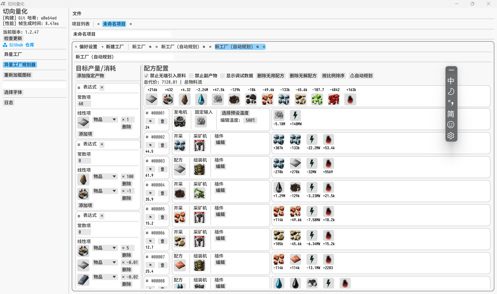

# 切向量化工具 Metatorio

> **Metatorio（切向量化）** 是作者「切向量」倾力打造的高性能《异星工厂》（Factorio）量化与自动化工厂规划工具。
> 软件名称巧妙运用了顶针修辞手法——从“切向量”到“切向量化”，在严谨的运筹学求解中不失灵动趣味。

[](https://www.rust-lang.org/)
[](https://tauri.app/)
[](LICENSE)

---

## ✨ 核心特性

- 🧮 **工业级线性规划（LP）多求解后端**：
  - **HiGHS**（默认推荐）：现代化高性能工业求解器，速度与数值稳定性兼备；
  - **SoPlex**：精准有理数单纯形求解器（集成 Boost 精确模式），杜绝浮点累计误差；
  - **Clarabel**：内点法（IPM）二次锥规划求解器；
  - **microlp**：纯 Rust 轻量级浮点求解器；
  - **rust-certified**（自研）：纯 Rust 编写的精确有理数重构与基解验证引擎。
- 🚀 **太空时代（Space Age）全机制与宇宙工厂支持**：
  - 深度支持 2.0+ 与 Space Age DLC：星球环境属性、火箭运力（质量/槽位）、轨道空投、变质周期、核聚变与多品质系统；
  - **宇宙工厂（Universe Factory）**：将各星球本地机制、火箭出口运输与轨道降落纳入全局线性规划联合求解。
- 📊 **灵活的产物线性表达式**：
  - 支持任意线性和比率目标表达式（如加权科研容量、跨品质成本权衡、压缩运输方案对比）。
- 🤖 **全局自动规划（Auto-Planner）**：
  - 基于科技树可达性（Accessibility）与环境约束，全排列枚举机器、配方、插件与插件塔组合，一步求解最优产能配置。
- 🎮 **真实游戏数据直接加载与原生图标渲染**：
  - 规避 Steam 启动确认中断，直接解包游戏本体与 Mod 原型数据（Lua dump 容错解析）；
  - 独立渲染引擎在进程内像素级合成层叠图标与品质标识。
- 🔌 **双模运行与 MCP 原生集成**：
  - 既是美观易用的现代化桌面 GUI 应用（Tauri v2 + Svelte 5）；
  - 也是标准 Model Context Protocol（MCP）服务端，支持直接接入外部 AI Agent 进行工厂审查与辅助规划。

> [!WARNING]
> **关于极端数值与状态空间膨胀的提示**：
> 在运行全局自动规划前，请留意所加载的游戏数据是否包含槽位异常膨胀的机器（例如使用 [Property Randomizer](https://mods.factorio.com/mod/propertyrandomizer) 模组生成的数十槽位机器）。由于组合爆炸，过多槽位会导致内存与规划耗时急剧上升。系统当前策略为：超过 8 个插件槽位的机器不会枚举空插件槽，且极端异常机器将仅考虑主流配置。

---

## 🚀 快速上手

### 1. 加载游戏数据
1. 初次使用或切换模组配置时，点击窗口右上角状态栏的 **「数据」** → **「加载游戏数据…」**；
2. 选择异星工厂可执行文件路径（例如 `factorio.exe`）；
3. （可选）选择模组文件夹路径（`mods/`）；
4. 确认后系统将就地解析原型数据并缓存，后续秒级恢复。

### 2. 基础规划流程
1. 点击左上角 **「项目」** → **「新建项目…」**（支持从同一菜单导入、保存或关闭项目）；
2. 点击顶部工厂栏右侧的 **「+」** 新建普通工厂，或点击 **「✦」** 新建多星球宇宙工厂；
3. **参数配置与目标设定（左侧栏）**：
   - **工厂 Tab**：设置运行环境（星球、地表、严格供给 / 严格消耗约束）、生产目标、外部输入与目标表达式；
   - **项目 Tab**：设定时间刻度（秒/分/小时）、**主品质**、品质上限、科技可达性、里程碑进度、配方/采矿/无限科技产能等级，以及自动规划的机器偏好与枚举配置；
4. **编辑与求解（中栏与右栏）**：
   - 目标行左侧图标可调整流类型，右键点击图标可逆向查看供给机制；
   - 点击中栏 **「+ 添加机制」** 可手动添加配方、采矿、燃料燃烧、变质、植物种植等机制；
   - 点击 **「自动规划」** 即可根据约束条件自动推导并填充最优机制组合（复杂问题推荐先开启严格供给模式）；
   - 右栏 **「求解结果」** 实时展示总生产成本与流平衡状态，点击条目末尾的 **「✦」** 按钮可查看针对该流的精准供给/消耗建议。

### 3. 多星球宇宙工厂（Universe Factory）
当生产链涉及跨星球物流调度时，使用 **「✦」** 按钮创建宇宙工厂：
- 各星球本地机制按各自环境属性（太阳能倍率、引力、地表约束）展开；
- 火箭运送消耗源星球的火箭运力（基于实际物品重量计算）并将产物送至太空；
- 太空产物经轨道空投（Orbital Drop）按堆叠规格与变质损耗投送至目标星球。
- 详细设计与数学模型详见 [宇宙工厂设计说明](docs/universe-factory.md)。

### 4. 项目文件与系统集成
- 项目默认保存为 `.metatorio` 文件（采用人类可读的 JSON 结构，并完全向后兼容旧版 `.json` 与 `.fpp` 工程）；
- 支持直接将工程文件拖拽到应用程序图标或窗口中打开；若已有运行中的 GUI 实例，系统将自动激活现有窗口并载入，避免重复启动。详见 [工程文件与加载链路](docs/project-files.md)。

---

## 📈 高级功能：产物表达式

生产目标不仅支持固定数值产出，还支持任意线性和比率表达式。例如：在太空时代（Space Age）背景下，探索高品质电磁科研包的最优生产策略。


> **计算实证**：在原版 + SA 条件下，只有粉瓶（生产科研包）值得追求精良及以上品质——不到一整带废料即可稳定产出一整带科研容量（不考虑物流拥堵前提下）。

更复杂的表达式亦可用于求解复合运输决策。例如在《太空探索》（Space Exploration）后期阶段，量化比较“制造铁锭运输后解压缩”与“直接制造铁板运输”的物流成本差异（前者可降低约 50% 的火箭与物流开销）：




---

## 🧩 模组生态兼容性

本工具已针对以下主流大型模组生态进行深度兼容与求解回归测试：
- ✅ **太空时代 DLC（Space Age）与全品质机制**
- ✅ **太空探索（Space Exploration）**
- ✅ **工业革命 / Krastorio 2 (K2)**
- ✅ **Pyanodons (Py 系列全套)**
- ✅ **无主之地（Nullius）**

异星工厂 2.0 及 2.1 版本的 dump 数据均可直接加载。

> [!TIP]
> 在涉及“原版 + 品质”、“太空探索 + 品质”或“Py 全家桶”求解传说级物品时，状态空间维度极高。建议在「项目设置」中合理控制允许枚举的插件种类与插件塔数量，防止内存过度消耗。

---

## 🛠️ 构建与开发环境

本仓库横跨 **Rust**（求解内核与外壳适配）、**C++**（底层运筹求解器集成）与 **TypeScript**（现代化响应式 UI）三种技术栈。

### 工具链依赖一览

| 组件 | 版本要求 | 承担职责 | 必需场景 |
| :--- | :--- | :--- | :--- |
| **Rust** | **≥ 1.85**（Edition 2024） | 求解器内核（`metatorio-solver` 等）+ Tauri 后端 | 全量编译 |
| **C++ 编译器** | 支持 C++17（MSVC 2022 / GCC / Clang） | 编译 HiGHS 与 SoPlex C++ 源码 | 默认特性构建 |
| **CMake** | **≥ 3.15** | HiGHS 与 SoPlex 构建系统 | 默认特性构建 |
| **Ninja**（可选） | 任意新版 | 加速 CMake 编译流程 | 推荐配置 |
| **LLVM / libclang** | LLVM 14+ | `highs-sys` 通过 bindgen 生成 C/C++ 绑定 | 默认特性构建 |
| **Node.js** | LTS 推荐 | 前端工程构建与脚本执行 | 前端 / 桌面端打包 |
| **pnpm** | 9.x | 前端依赖管理与命令编排 | 前端 / 桌面端打包 |
| **Tauri v2 系统库** | 见各平台说明 | 桌面原生视窗与系统集成 | 桌面端打包（尤其是 Linux） |

> [!NOTE]
> 默认构建启用了 Clarabel、HiGHS、microlp、SoPlex 以及纯 Rust 求解后端。
> 如需进行免 C++ 工具链的纯 Rust 开发，可使用纯 Rust 特性组合：
> ```sh
> cargo test --workspace --no-default-features --features clarabel,microlp,rust-lp
> ```

### 平台依赖一键配置

#### Windows（以 VS 2022 C++ 生成工具为例）
```powershell
winget install Kitware.CMake Ninja-build.Ninja LLVM.LLVM
# 安装后确保 C:\Program Files\LLVM\bin 已加入系统 PATH（或设置 LIBCLANG_PATH 环境变量）
```

#### Ubuntu / Debian
```sh
sudo apt update
sudo apt install build-essential cmake ninja-build clang libclang-dev
# Tauri v2 桌面视窗依赖：
sudo apt install libwebkit2gtk-4.1-dev libappindicator3-dev librsvg2-dev patchelf libssl-dev
```

### 常用开发与测试命令

```sh
# 1. 运行求解器测试（纯 Rust 单纯形模式，无需 C++ 工具链，速度最快）
cargo test -p metatorio-solver --no-default-features --features microlp,rust-lp

# 2. 全工作区 Rust 单元测试与集成测试（需 C++ 编译器与 CMake）
cargo test --workspace

# 3. 运行真实游戏数据长回归用例（约耗时数分钟）
cargo test --release -p metatorio-runtime --lib legendary_biter_egg -- --ignored --nocapture

# 4. 前端开发服务启动（在 metatorio-app 目录下执行）
cd metatorio-app
pnpm install
pnpm dev

# 5. 生成与校验 TypeScript / Rust 强类型 IPC 合约
cd metatorio-app
pnpm bindings:check

# 6. 桌面端应用打包构建
cd metatorio-app
pnpm tauri build
```

> [!IMPORTANT]
> **依赖管理准则**：
> 前端 `pnpm` 命令必须在 `metatorio-app/` 子目录下执行，严禁在仓库根目录下初始化 `package.json` 或 `node_modules`。

---

## 📚 架构与技术文档导航

- 🤖 [**AGENTS.md**](AGENTS.md)：面向 AI Agent 与核心贡献者的全景代码阅读导引与架构速查字典。
- 🔄 [**类型化 IPC 架构**](docs/typed-ipc.md)：基于 `tauri-specta` 的 Rust 与 TypeScript 强类型绑定与契约守护。
- 🌌 [**宇宙工厂设计与数学模型**](docs/universe-factory.md)：多星球环境隔离、火箭运输成本与轨道空投规划。
- 🗂️ [**工程文件与加载链路**](docs/project-files.md)：单实例唤醒、命令行启动传参、BOM 容错与文件关联。
- 🖥️ [**Windows 原生构建排查指南**](docs/windows-native-build.md)：MSVC、CMake、Ninja 与 PDB 锁问题解决指南。
- 🧪 [**自动规划测试说明与实测数据**](docs/auto-plan-testing.md)：极端倍率、插件塔拓扑与全产物遍历测试集。
- 📐 [**LP 求解器算法调研与技术演进**](docs/lp-algorithm-survey-20261024.md)：单纯形法、内点法与有理数重建的性能全对比。

---

## 🤝 贡献与反馈

非常欢迎提交 Issue、发起 Pull Request 或提出针对新模组与新机制的适配需求！

- **提交 Issue**：若遇到特定配方无法求解、自动规划状态异常或界面渲染问题，欢迎附带 `.metatorio` 工程文件或复现步骤。
- **Pull Request**：提交代码前请确保运行 `cargo test --workspace` 以及 `cd metatorio-app && pnpm check` 验证通过。

## 📄 开源许可

本项目遵循 [MIT 许可证](LICENSE) 开源。
