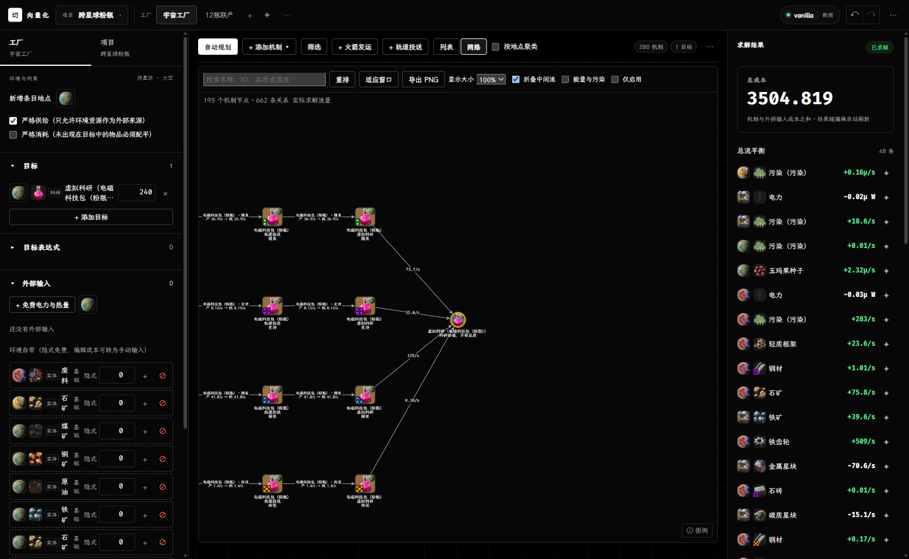
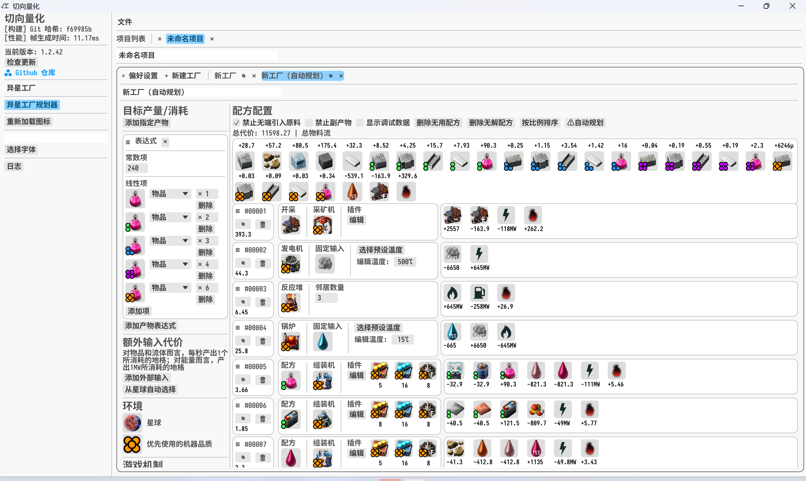
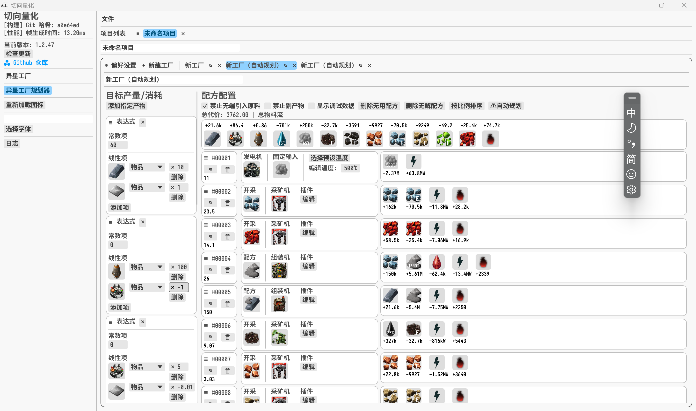

# 切向量化工具 Metatorio

切向量化（Metatorio）是切向量制作中的《异星工厂》（Factorio）量化计算与工厂规划工具。从“切向量”到“切向量化”使用了顶针的修辞手法，令人忍俊不禁。

[-orange.svg)](https://www.rust-lang.org/)
[](https://tauri.app/)
[](LICENSE)

> [!WARNING]
> **关于离谱数值模组与状态空间膨胀的提示**：
> 运行自动规划前，请先确认当前游戏数据不会把状态空间撑爆。例如使用了 [Property Randomizer](https://mods.factorio.com/mod/propertyrandomizer) 产生几十个插件槽的机器时，全排列组合会直接把内存和耗时送上天。目前的临时规则是：超过 8 个插件槽位的机器不会枚举空插件槽，槽位过多的机器会忽略绝大多数配置组合。

---

## 功能概览

- **五种可选线性规划（LP）后端**：
  - **HiGHS**（新项目默认）：C++ 单纯形求解器，包含针对数值退化循环的重试阶梯；
  - **SoPlex**：通过内置补丁和 `Boost.Multiprecision` 运行在精确有理数模式，消除浮点舍入误差；
  - **Clarabel**：纯 Rust 内点法求解器；
  - **microlp**：纯 Rust 单纯形求解器；
  - **rust-certified**（界面显示 `Rust based`）：自研纯 Rust 精确重构与基验证引擎（传统默认，为兼容旧工程保留该序列化 ID）。
- **太空时代（Space Age）与跨星球宇宙工厂**：
  - 支持 2.0 / 2.1 与太空时代 DLC 机制：星球环境参数、火箭运力（按重量或槽位）、轨道空投、变质周期、聚变反应堆/发电机、虚拟科研与多品质分布；
  - **宇宙工厂（Universe Factory）**：将多个行星地表与太空轨道放入同一张 LP 模型联合求解，详见 [宇宙工厂设计与数学模型](docs/universe-factory.md)。
- **目标表达式**：
  - 除固定产出速率外，支持任意线性与比率目标表达式（例如科研包跨品质加权成本，或不同中间体形态的运输开销对比）。
- **自动规划（Auto-Planner）**：
  - 按科技树可达性与表面建造条件枚举配方、机器、插件与插件塔组合，一次性交给 LP 求解并写回非零机制。
- **游戏数据直读与进程内图标渲染**：
  - 仅调用游戏无头命令行导出数据与本地化文本，图标由 `metatorio-icons` 直接读取游戏目录及 Mod zip 像素级合成，避免 `--dump-icon-sprites` 在 Steam 下弹出确认框打断流程。
- **桌面界面与 MCP 接入**：
  - 桌面端基于 Tauri v2 + Svelte 5（默认带列表视图与 Cytoscape + ELK 网络视图）；
  - 内置 Streamable-HTTP MCP 服务端（支持局域网/移动端接入），另有不链接任何 GUI 工具包的独立 `metatorio-headless` 可执行文件。

---

## 使用方法

### 1. 加载游戏数据
1. 初次使用或更换模组配置时，点击右上角状态栏的 **「数据」** → **「加载游戏数据…」**；
2. 选择 `factorio.exe`（或 Linux 可执行文件）路径，按需选择 `mods/` 目录（留空则只加载原版与已安装的官方 DLC）；
3. 确认后程序会解析并按内容哈希缓存在本地，后续打开直接恢复。

### 2. 基本规划流程
1. 点击左上角 **「项目」** → **「新建项目…」**（同一菜单也支持打开、保存和关闭工程）；
2. 点击顶部工厂栏右侧 **「+」** 新建普通工厂，或点击 **「✦」** 新建多星球宇宙工厂；
3. **左侧栏（参数与目标）**：
   - **工厂 Tab**：配置星球、地表（如 `space-platform`）、严格供给/严格消耗约束、生产目标、外部输入及目标表达式；
   - **项目 Tab**：配置显示时间刻度（内部求解单位始终为每秒）、**主品质**、品质上限、可达性、里程碑、产能加成、LP 求解后端与自动规划枚举偏好；
4. **中栏与右栏（编辑与求解）**：
   - 目标行左侧图标可修改流类型，右键点击可反查能够供给它的机制；
   - 点击 **「+ 添加机制」** 手动添加配方、采矿、燃料燃烧、变质、种植、发电或星际货运等机制；
   - 点击 **「自动规划」** 会按当前约束枚举候选并自动填入最优组合（规划固定按严格供给求解并在完成后开启严格供给；如果无解，先检查是否漏加外部输入或把目标填成了每分钟数量）；
   - 右栏 **「求解结果」** 展示总成本、优化诊断与流平衡，点击条目末尾 **「✦」** 可查看供给/消耗建议。

### 3. 工程文件与多开行为
- 工程默认保存为 `.metatorio`（内部仍为人类可读 JSON，兼容旧版 `.json` 与 `.fpp` 工程）；
- 支持将工程文件直接拖到桌面图标或窗口中打开；已有 GUI 实例运行在当前桌面时，新启动会自动把文件路径转交并激活现有窗口，详见 [工程文件与加载链路](docs/project-files.md)。

---

## 界面与计算示例

### 多星球宇宙工厂与网络视图（当前桌面版）

12 种科研包跨星球联合求解列表视图（Tauri v2 + Svelte 5 界面）：


跨星球电磁科研包网络拓扑视图（含星际火箭发射、轨道空投与跨品质分流流量标注）：



### 产物表达式示例

（以下三条截图来自早期版本，新版操作布局有所调整，数值逻辑不变。）

在生产目标中使用线性表达式，可以直接求算太空时代下高品质科研包的最优成本配比：



> 按原版 + SA 数据计算：只有粉瓶（生产科研包）值得生产精良及以上品质——不到一整带废料即可稳定产出一整带科研容量（未计物流拥堵成本）。

表达式也可以用于比较规划器本身不会直接决策的运输形态。例如在《太空探索》（Space Exploration）后期，比较“在当地压成铁锭运走再解压缩”与“直接运输铁板”的火箭与物流成本差异（前者约为后者的一半）：




---

## 模组生态兼容性

已实际测过以下大型模组或生态的 2.0 / 2.1 dump 数据：
- **太空时代 DLC（Space Age）**
- **太空探索（Space Exploration）**
- **Krastorio 2 (K2)**
- **Pyanodons (Py 系列)**
- **无主之地（Nullius）**

> [!TIP]
> 在“原版 + 品质”、“太空探索 + 品质”或“Py 全家桶”下直接自动规划传说品质产物时，候选矩阵可能达到百万列级别并耗尽内存。建议在「项目设置」里收敛枚举的插件种类与插件塔布局，不要全开。

---

## 构建与开发环境

仓库包含 **Rust**（求解、运行时、外壳与无头服务）、**C++**（HiGHS / SoPlex 底层库）与 **TypeScript / Svelte 5**（桌面界面）。

### 工具链要求

| 组件 | 版本要求 | 用途 | 什么时候需要 |
| :--- | :--- | :--- | :--- |
| **Rust** | **nightly**（Edition 2024） | 全部 Rust crate（`metatorio-data` 使用 `#![feature(mut_restriction)]`） | 全量编译 |
| **C++ 编译器** | 支持 C++17（MSVC 2022 / GCC / Clang） | 编译 HiGHS 与 SoPlex C++ 源码 | 默认特性或开启 `highs` / `soplex` |
| **CMake** | **≥ 3.15** | HiGHS 与 SoPlex 构建系统 | 同上 |
| **Ninja**（推荐） | 任意新版 | 加速 CMake 编译并规避部分 VS 生成器探测问题 | 同上 |
| **LLVM / libclang** | LLVM 14+ | `highs-sys` 通过 `bindgen` 生成 C 绑定 | 同上 |
| **Node.js** | LTS | 前端构建与脚本测试 | 前端 / 桌面端打包 |
| **pnpm** | 9.x | 前端依赖管理与命令编排 | 前端 / 桌面端打包 |
| **Tauri v2 系统库** | 见下方系统安装命令 | WebKitGTK 与系统托盘/图标库 | Linux 桌面端构建 |

> [!NOTE]
> 如需在没有 C++ / CMake / LLVM 环境的机器上仅验证纯 Rust 代码，可关闭默认特性并启用纯 Rust 后端：
> ```sh
> cargo test --workspace --no-default-features --features clarabel,microlp,rust-lp
> ```

### 环境安装

**Windows**（需先安装 VS 2022 C++ 生成工具）：
```powershell
winget install Kitware.CMake Ninja-build.Ninja LLVM.LLVM
# 安装后确保 C:\Program Files\LLVM\bin 在 PATH 中，或设置 LIBCLANG_PATH 环境变量
```

**Ubuntu / Debian**：
```sh
sudo apt update
sudo apt install build-essential cmake ninja-build clang libclang-dev
# Tauri v2 桌面端额外依赖：
sudo apt install libwebkit2gtk-4.1-dev libappindicator3-dev librsvg2-dev patchelf libssl-dev
```

### 常用命令

```sh
# 1. 纯 Rust 单纯形求解器单测（无需 C++ 工具链，最快）
cargo test -p metatorio-solver --no-default-features --features microlp,rust-lp

# 2. 全工作区 Rust 测试（需 C++17 / CMake / libclang）
cargo test --workspace

# 3. 真实游戏数据长回归用例（约耗时数分钟）
cargo test --release -p metatorio-runtime --lib legendary_biter_egg -- --ignored --nocapture

# 4. 前端开发与类型检查（必须在 metatorio-app 目录下执行）
cd metatorio-app
pnpm install
pnpm check
pnpm dev

# 5. 生成并校验 Rust / TypeScript IPC 绑定
cd metatorio-app
pnpm bindings
pnpm bindings:check

# 6. 桌面端打包
cd metatorio-app
pnpm tauri build
```

> [!IMPORTANT]
> 前端 `pnpm` 命令请在 `metatorio-app/` 子目录下运行，不要在仓库根目录执行 `npm install` 或生成根级 `node_modules`。

---

## 文档导航

- [**AGENTS.md**](AGENTS.md)：仓库拓扑、核心领域抽象与关键不变量速查。
- [**分层与核心/外壳不变量**](docs/shell-architecture.md)：Tauri / Headless 共用 `metatorio-shell` 的边界约束。
- [**Runtime 并发与锁纪律**](docs/runtime-concurrency.md)：`Mutex<Runtime>` 锁边界、快照与异步作业调度。
- [**宇宙工厂设计与数学模型**](docs/universe-factory.md)：多星球坐标、火箭重量与轨道空投模型。
- [**类型化 IPC 架构**](docs/typed-ipc.md)：基于 `tauri-specta` 的 Rust / TypeScript 契约同步。
- [**MCP 服务端设计**](docs/mcp-design.md)：工具面、安全边界与局域网接入说明。
- [**工程文件与加载链路**](docs/project-files.md)：单实例唤醒、文件关联与多格式导入。
- [**进程内图标渲染**](docs/icon-rendering.md)：图层合成规则、模组目录解析与缓存设计。
- [**Windows 原生构建排查**](docs/windows-native-build.md)：CMake 生成器与 MSVC PDB 问题处理。

---

## 反馈与许可

遇到无法求解的配方、自动规划异常或界面问题，欢迎提交 Issue（最好附上 `.metatorio` 工程文件与所用游戏版本/模组列表），也欢迎提交 Pull Request 或在其它社区联系我交流。

本项目遵循 [MIT 许可证](LICENSE) 开源。
